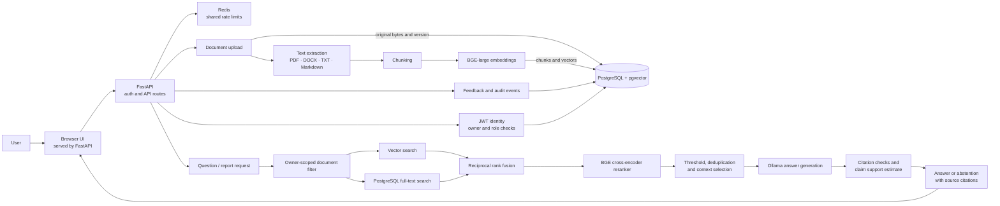

# Enterprise Knowledge Intelligence Platform

Document-grounded company knowledge search with authenticated document management, hybrid retrieval, reranking, source citations, and local Ollama answer generation.

## Architecture



FastAPI serves the UI and API from one origin. PostgreSQL stores users, document/version metadata, original upload bytes, extracted chunks, and embeddings. Redis supports shared rate limiting. Ollama is the only generation provider and runs locally; claim verification is a model-assisted estimate, not proof of factual correctness.

## Repository map

```text
backend/app/          FastAPI application and service modules
backend/tests/        Unit and API tests
scripts/              Evaluation, smoke-data, and retrieval-debug commands
frontend/             Runnable browser app
frontend/designs/     Stitch exports and screenshots retained as references
migrations/           Alembic database migrations
test_data/            Synthetic fixture documents and source corpus
reports/evaluation/   Latest machine-readable and Markdown evaluation outputs
reports/evaluation/archive/  Earlier evaluation and smoke outputs
docs/                 Audit and deployment guidance
stored_documents/     Legacy originals retained for the one-time DB migration
```

## Local development

Use the Conda environment and the existing local PostgreSQL/pgvector, Redis, and Ollama services. Configure private settings in your local `.env`; never commit it. Original upload bytes and extracted data are stored in PostgreSQL. The app serves the browser interface and API from one origin.

```powershell
conda activate enterprise-rag
$env:PYTHONPATH = (Resolve-Path .\backend).Path
python -m alembic upgrade head
python scripts\migrate_document_files.py
python scripts\migrate_document_files.py --verify-only
python -m uvicorn app.main:app --app-dir backend --host 127.0.0.1 --port 8000
```

The migration utility copies legacy originals into PostgreSQL after verifying their SHA-256 checksums. It never deletes or changes local files. Review its JSON counts and require a clean `--verify-only` run before manually retiring old copies. Ollama is the only generation provider; start Ollama and ensure the configured model is available with `ollama pull qwen3.5:4b`.

Open `http://127.0.0.1:8000/`. For tests, run `python -m pytest backend -q`. For the live fixed RAG evaluation, run `python scripts\evaluate_rag.py`; append `--semantic-judge` to request model-assisted estimates. The five-document HTTP smoke harness is `python scripts\setup_test_data.py` and uploads documents to the configured database.

See [deployment instructions](docs/DEPLOYMENT.md), [audit and evaluation notes](docs/AUDIT_REPORT.md), and the [frontend guide](frontend/README.md).

The workspace also includes an authenticated **Reports** page for structured, source-grounded Markdown reports, DOCX table extraction, PDF page markers, and opt-in local OCR for scanned PDF pages. OCR requires the optional Python dependencies plus locally installed Poppler and Tesseract. RAGAS scoring is optional and uses local Ollama/BGE; see `docs/DEPLOYMENT.md` for the exact commands and limitations. GraphRAG is intentionally deferred until evaluation demonstrates a meaningful multi-hop retrieval gap.
