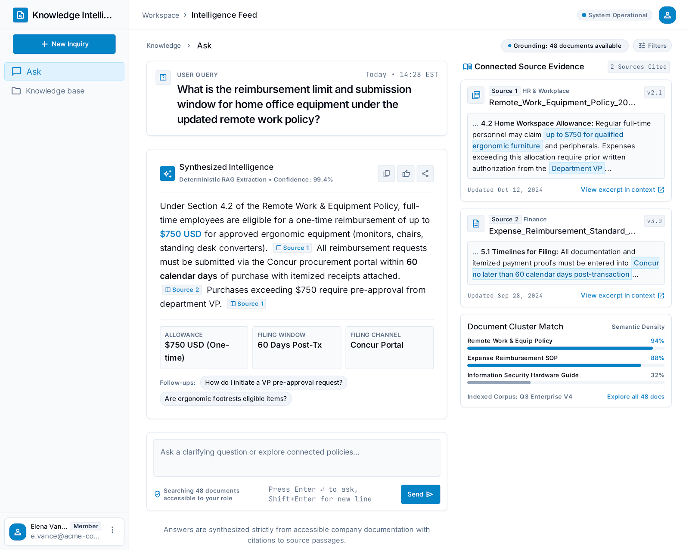
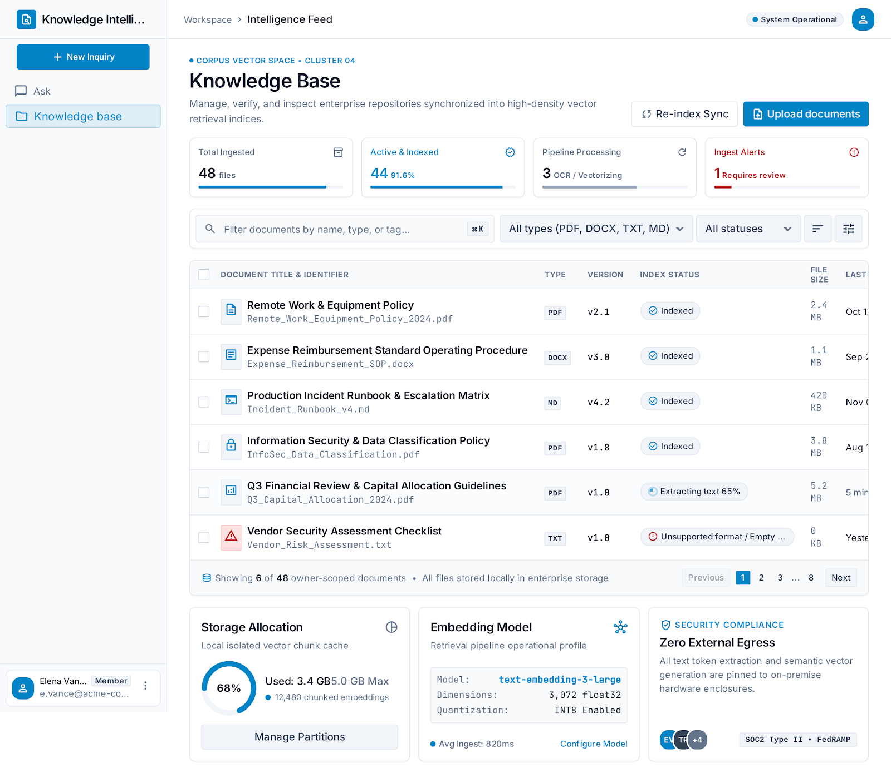
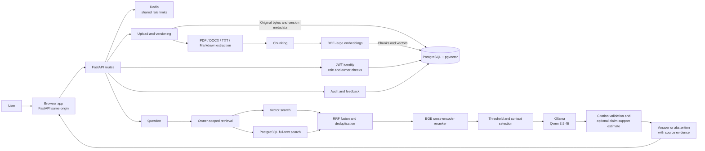

# Enterprise Knowledge Intelligence Platform

**A local-first, document-grounded knowledge assistant for enterprise teams.** Upload policy and business documents, ask questions in natural language, and inspect the retrieved evidence behind each answer.

The project combines a FastAPI application, PostgreSQL with pgvector, hybrid retrieval, BGE reranking, and local Ollama generation. It includes an authenticated web interface, versioned document management, source citations, abstention, and a fixed-case RAG evaluation suite.

> **Project status:** functional research/prototype, not a hardened production service. The latest complete saved 34-case evaluation (2026-10-29) passes 31/34 cases and closes the prior verifier accuracy gap: verified approximate expected-fact accuracy is now 93.10%, versus 92.86% for the verification-disabled baseline (one baseline generation error). See [Evaluation](#evaluation) for the results and remaining limitations.

## At a glance

- **Ingestion:** PDF, DOCX, TXT, and Markdown; text extraction, overlapping chunks, BGE embeddings, document versioning, exact duplicate detection.
- **Persistence:** PostgreSQL stores account/document metadata, original uploaded bytes, chunks, and 1024-dimensional vectors. Redis supports shared rate limiting.
- **Retrieval:** owner-filtered vector search and PostgreSQL full-text search, fused with reciprocal rank fusion (RRF), then scored by a BGE cross-encoder.
- **Answers:** Ollama with `qwen3.5:4b` by default. Answers include source labels; unsupported questions should abstain. Claim verification is a model estimate, not proof.
- **Web app:** sign-up/sign-in, document library and versions, upload/download/delete, grounded Q&A with evidence, reports, feedback, and admin audit view.
- **Evaluation:** fixed 34-case dataset with document- and pinned chunk-level retrieval labels, machine-readable results, approximate phrase checks, abstention and citation-label checks, and latency reporting.

## Screenshots

| Ask with citations | Document library |
|---|---|
|  |  |

The screenshots are representative UI states from the Stitch design set; actual answers and document contents depend on the database and current session.

## Architecture



FastAPI serves the web application and API from one origin. PostgreSQL is the persistent store for original uploads and derived retrieval data. Ollama is the only supported generation provider. The embeddings and reranker are separate models: embeddings provide vector-search candidates; the cross-encoder scores query/chunk pairs after hybrid retrieval.

See [Architecture and data flow](docs/ARCHITECTURE.md) for the detailed request path, storage boundaries, and access-control notes.

## Evaluation

The figures below are copied from the repository's **latest complete saved result artifact**: [`enterprise_rag_evaluation_20261029T072902Z.json`](reports/evaluation/enterprise_rag_evaluation_20261029T072902Z.json) and its [Markdown report](reports/evaluation/enterprise_rag_evaluation_20261029T072902Z.md). It contains 34 cases (34 completed, 0 failed), dataset `enterprise-rag-v1`, BGE-large embeddings, BGE-reranker-base, `qwen3.5:4b`, top 5 context chunks, and threshold `0.001` (source recorded as environment). The run used live PostgreSQL/Redis/Ollama on 2026-10-29.

| Metric | Latest result | How to interpret it |
|---|---:|---|
| Overall pass rate | **91.18% (31/34)** | Combined pass criteria in the fixed evaluator |
| Query retrieval success@5 | **100% (29/29)** | At least one expected source was retrieved for each answerable query |
| Expected source-label Recall@5 | **96.67% (29/30)** | Micro recall over all expected source-document labels |
| Expected source-label Precision@5 | **20.00%** | 29 relevant labels / 145 fixed top-five slots; thresholding returned 2.59 contexts per answerable query on average |
| Chunk-complete Recall@5 | **96.55% (28/29)** | Every expected document had an expected chunk in context |
| Chunk-label recall@5 | **96.67% (29/30)** | Fraction of expected document/chunk labels retrieved |
| Chunk MRR / nDCG@5 | **0.9655 / 0.9739** | Ranking of labeled chunks |
| Document MRR / nDCG@5 | **1.000 / 0.9867** | Best-match document ranking; nDCG penalizes missing multi-document labels |
| Approx. expected-fact accuracy | **93.10% (27/29)** | Phrase-based answer check; not semantic validation |
| Approx. expected-fact coverage | **96.00%** | Phrase-based coverage of required facts |
| Evidence expected-fact coverage | **100%** | Expected fact phrases were found in retrieved evidence according to the evaluator's approximate check |
| Citation-label validity | **100% (31 scored answers)** | Labels mapped to returned sources; this does **not** prove entailment |
| Abstention correctness | **80% (4/5 unsupported cases)** | The evaluator judged four unsupported cases as abstained correctly |
| Unsupported queries with empty retrieval | **60%** | The other unsupported queries retrieved something; generation still needs to abstain correctly |
| Retrieval + generation latency | **1.44 s / 4.65 s** | Average / P95 calculated from recorded retrieval and generation times; excludes verification |
| End-to-end verified latency | **3.08 s / 7.82 s** | Average / P95 for the complete answer service; single development-machine run, not a controlled benchmark |

### Verifier regression: diagnosis and current status

The earlier saved artifact [`enterprise_rag_evaluation_results.json`](reports/evaluation/enterprise_rag_evaluation_results.json) reported **51.72% verified approximate expected-fact accuracy versus 96.43% for the verification-disabled baseline**, with 14 answerable cases withheld as `missing_citation`. The dominant cause was not that the underlying answers were wrong. The verifier parsed uncited introductory/meta sentences (for example, “Based on the retrieved evidence, here is the information that belongs in an incident report:”) as factual claims, marked them unsupported, and the all-or-nothing policy then discarded the entire answer. Phrase checks saw the abstention text and scored every expected fact as missing.

Two changes fixed this:

1. Uncited discourse lead-ins, headings, and colon-ending framing sentences are excluded from claim verification, while cited factual sentences are always kept.
2. Verification is now incremental: supported claims are retained and unsupported sentences are removed. The answer is rejected, retried, and withheld only when no claim is supported. The verifier's source mapping can also repair a missing citation label.

In the latest run, **0 answerable cases were withheld** (31 verified, 3 abstained), and verified accuracy is 93.10% versus 92.86% for the unverified baseline. The baseline is scored over 28 of 29 answerable cases because one baseline generation failed; the verified pipeline was scored over all 29. Four verified answers had at least one unsupported sentence removed. The verifier is therefore no longer an accuracy drag on this dataset, but this does not prove it improves factual correctness: the lexical metric is approximate and the verifier is the same local model used for generation.

Three cases still fail: case 21 misses the phrase “pull request” because the answer paraphrases it (both baseline and verified fail); case 28 is a multi-document question whose IT-security chunk was not retrieved, so its unsupported sentence was correctly removed and the chunk metric records the miss; case 34 asks which conflicting approval policy “wins” and both baseline and verified answers infer a precedence rule that no document states — the local verifier did not catch that evaluative claim. The RAG evaluation artifact includes no semantic-judge scores; the separate RAGAS estimates are shown below.

### RAGAS estimates

The separate [RAGAS report](reports/evaluation/ragas_comparison_20261029T080223Z.md) scores 29 answerable cases with usable answers, references, and retrieved contexts; all four metrics completed without failures. The judge was local Ollama `qwen3.5:4b` and references are approximate.

| Metric | Estimate | Qualification |
|---|---:|---|
| Faithfulness | **0.9713** | Local-model estimate, not a measured hallucination rate |
| Answer relevancy | **0.8852** | Question/answer relevance estimate |
| Context precision | **0.9425** | Approximate because references are synthesized from expected facts |
| Context recall | **0.9598** | Approximate because references are synthesized from expected facts |

Hallucination rate was not independently measured. `1 - faithfulness` is a **2.87% unsupported-claim proxy**, not a verified hallucination rate. The [detailed metric definitions and results](results.txt) explain the fixed-K precision denominator, service latency scope, and evaluation limitations. No RAGAS baseline comparison is claimed.

An earlier timestamped run is explicitly **partial**: 30 of 34 cases completed and four failed during verification. Its 96.67% pass rate applies only to those completed cases and is not comparable to a full-suite pass rate. It is retained as history, not used as the headline metric.

All phrase-based metrics are approximate. Query retrieval success, source-label recall, and chunk-complete recall use different definitions; all are reported separately. Precision@5 uses a fixed denominator of five even when thresholding returns fewer contexts. Citation-label validity confirms only that a label points to a retrieved source; it does not establish factual support. The verifier and RAGAS judge use local models and are not independent evidence. See the [evaluation report](reports/evaluation/enterprise_rag_evaluation_20261029T072902Z.md) and [audit report](docs/AUDIT_REPORT.md) for details.

## Quick start: Windows PowerShell

### Prerequisites

- Windows 11 and Conda; the project environment is named `enterprise-rag`.
- PostgreSQL with the `pgvector` extension and Redis, running locally or through Docker Compose.
- Ollama running locally, with the configured model available. The default is `qwen3.5:4b`.
- Python 3.11 and the dependencies in `requirements.txt`.

Keep credentials and private configuration in your local `.env`. Do not commit that file. `.env.example` documents the available settings.

### Run with local PostgreSQL/Redis and local Ollama

Create the Conda environment and install the Python dependencies:

```powershell
conda create -n enterprise-rag python=3.11 -y
conda activate enterprise-rag
python -m pip install -r requirements.txt
```

Create `.env` from the example only if you do not already have a local one, then edit the private values manually. The application needs a PostgreSQL password and a JWT signing secret of at least 32 characters. Start PostgreSQL and Redis from Compose, and start Ollama separately:

```powershell
if (-not (Test-Path .env)) { Copy-Item .env.example .env }
docker compose up -d postgres redis
ollama pull qwen3.5:4b
```

Then, from the repository root, apply the schema migrations:

```powershell
$env:PYTHONPATH = (Resolve-Path .\backend).Path
conda activate enterprise-rag
python -m alembic upgrade head
```

If you have legacy originals in `stored_documents/`, migrate and verify them before relying only on PostgreSQL storage:

```powershell
python scripts\migrate_document_files.py
python scripts\migrate_document_files.py --verify-only
```

The migration tool copies and checksum-verifies files; it does not delete the local copies. Then start the API:

```powershell
python -m uvicorn app.main:app --app-dir backend --host 127.0.0.1 --port 8000
```

Open [http://127.0.0.1:8000/](http://127.0.0.1:8000/). The interactive API schema is at [http://127.0.0.1:8000/docs](http://127.0.0.1:8000/docs). If port 8000 is already occupied, stop the existing server or choose another port.

### Run with Docker Compose

Configure the required private values in `.env`, then run:

```powershell
docker compose up -d postgres redis
docker compose build api
docker compose run --rm api python -m alembic upgrade head
docker compose run --rm api python scripts/migrate_document_files.py --verify-only
docker compose up -d api
docker compose ps
```

If legacy files have not yet been imported, run the migration command without `--verify-only`, then verify. Compose exposes the API on `127.0.0.1:8000` and connects to host Ollama using `host.docker.internal`. See [Deployment](docs/DEPLOYMENT.md) for full instructions and operational constraints.

## Tests and evaluation

From the repository root with the Conda environment active:

```powershell
conda activate enterprise-rag
$env:PYTHONPATH = (Resolve-Path .\backend).Path
python -m compileall -q backend migrations scripts
python -m pytest backend -q --tb=short -p no:cacheprovider --basetemp .pytest-tmp-local
```

The live RAG evaluation requires the seeded evaluation user, database, BGE models, and a running Ollama instance. It calls the local model and writes new results under `reports/evaluation/`:

```powershell
python scripts\evaluate_rag.py
```

To include optional model-assisted estimates, run `python scripts\evaluate_rag.py --semantic-judge`. It uses local Ollama; those estimates are not independent proof. The five-document HTTP smoke harness can upload or version documents and requires a running API plus dedicated `RAG_EVAL_EMAIL` and `RAG_EVAL_PASSWORD`; run it only when that database change is intended.

## Configuration highlights

| Setting | Default in example | Purpose |
|---|---|---|
| `OLLAMA_MODEL` | `qwen3.5:4b` | Local answer and verifier model |
| `OLLAMA_NUM_CTX` | `4096` | Ollama context window |
| `OLLAMA_NUM_PREDICT` | `700` | Maximum generated tokens |
| `OLLAMA_KEEP_ALIVE` | `5m` | Keep model loaded between calls |
| `EMBEDDING_MODEL_NAME` | `BAAI/bge-large-en-v1.5` | Vector encoder; 1024 dimensions by default |
| `RERANKER_MODEL_NAME` | `BAAI/bge-reranker-base` | Query/chunk cross-encoder |
| `RERANKER_SCORE_THRESHOLD` | `0.001` | Provisional relevance threshold; not a probability |
| `RAG_CLAIM_VERIFICATION_ENABLED` | `true` | Enable local model-assisted claim checks |

Batch sizes and device choices can be tuned through the environment, but larger batches may increase RAM/VRAM use. Changing the embedding model requires confirming dimensions and re-embedding every stored chunk; never mix vectors from different encoders in one index. See [RAG pipeline notes](docs/RAG_PIPELINE_NOTES.md).

## Security and current limitations

- API ownership comes from the authenticated JWT identity; document and query paths enforce owner/admin access filters. Registration assigns the member role; it does not provide self-service admin promotion.
- Passwords are hashed. Original files are persisted in PostgreSQL, with version records and owner-scoped download/deletion.
- Redis-backed rate limiting can be configured to fail closed. Local process-only fallback is not shared between workers.
- This repository does not provide MFA, password reset, account lockout, enterprise SSO, TLS termination, managed backups, or production alerting. Do not expose the local Compose setup directly to the public internet.
- Browser automation and assistive-technology verification are not configured; manual cross-browser, keyboard, screen-reader, and responsive checks remain.
- Evaluation is small and approximate. The latest complete 34-case run passes 31/34; its remaining failures are a paraphrase missed by the phrase check, one multi-document retrieval miss, and one unsupported conflict-precedence answer the local verifier did not catch.
- Fine-tuning is not part of the runtime pipeline. The optional Colab notebook now groups positive and negative source-document IDs and bases candidate selection on validation results; its small triplet-candidate metrics still do not establish production retrieval quality.
- GraphRAG is deferred until evaluation demonstrates a meaningful multi-hop retrieval gap.

## Repository layout

```text
backend/app/             FastAPI routes, data models, and RAG services
backend/tests/           Unit and API tests
frontend/                Runnable same-origin browser application
frontend/designs/        Stitch design references and screenshots
migrations/              Alembic schema migrations
scripts/                 Evaluation, migration, fixture, and debug scripts
test_data/               Synthetic enterprise fixtures
reports/evaluation/      Machine-readable results and Markdown reports
docs/                    Architecture, deployment, and audit documentation
notebooks/               Optional research experiments (not runtime code)
```

## Documentation

- [Product requirements (PRD)](docs/PRD.md)
- [Engineering and repository rules](docs/RULES.md)
- [Database design and data lifecycle](docs/DATABASE.md)
- [Architecture and data flow](docs/ARCHITECTURE.md)
- [Deployment and local setup](docs/DEPLOYMENT.md)
- [Audit findings and evaluation limitations](docs/AUDIT_REPORT.md)
- [RAG pipeline configuration and evaluation notes](docs/RAG_PIPELINE_NOTES.md)
- [Frontend behavior and browser verification](frontend/README.md)
- [License](LICENSE) (Apache-2.0)

## Contributing

Issues and focused pull requests are welcome. For changes to retrieval, generation, or evaluation, include regression tests and report the dataset, model configuration, threshold, completed/failed case counts, and whether the run used live services. Never report partial evaluation metrics as full-suite results or include secrets, private documents, or `.env` files in a commit.
