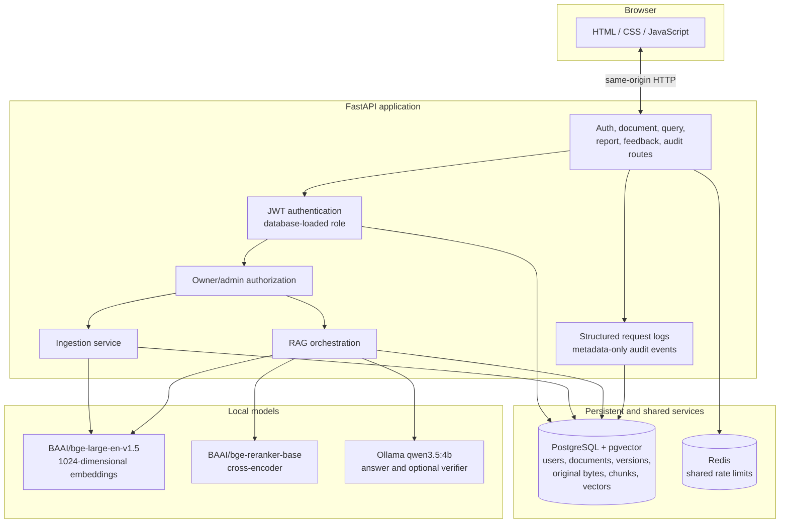

# Architecture and data flow

## Runtime components

## Document ingestion and storage

1. An authenticated user uploads a PDF, DOCX, TXT, or Markdown file. The API enforces a 20 MiB limit and checks the file type.
2. The ingestion service hashes the original bytes. An exact duplicate for the same owner is detected before re-extraction and re-embedding.
3. A changed upload under the same owner and filename becomes a new document version.
4. The service extracts text, chunks it with overlap, counts tokens with the configured BGE tokenizer, embeds the chunks, and persists the original bytes, version metadata, chunks, and vectors in PostgreSQL.
5. The database transaction keeps file/version/chunk updates consistent. PostgreSQL-backed original download, version listing, and owner-scoped deletion use the same authorization boundary.

Legacy originals may remain under `stored_documents/`. `scripts/migrate_document_files.py` copies them into the database and verifies checksums. The utility does not remove local files; run `--verify-only` and review its results before manually retiring copies.

## Question and answer path

1. The API derives the user identity and role from the bearer token. A caller-supplied owner ID is not the authorization source.
2. Hybrid retrieval independently performs pgvector similarity search and PostgreSQL full-text search. Both queries filter to the authenticated owner unless an administrator is authorized to search across owners.
3. Reciprocal rank fusion combines the lists. The BGE cross-encoder re-scores candidate query/chunk pairs.
4. The configured score threshold is applied, duplicate chunks are removed, and up to five chunks are assembled as context.
5. Ollama generates an answer with source labels. The verifier performs deterministic citation-number checks and may ask Ollama for a claim-support estimate. Uncited discourse lead-ins are skipped; cited factual sentences are retained. If at least one claim is supported, the answer is kept without its unsupported sentences; if none is supported, the service retries once and then withholds the answer. Operational verifier errors are surfaced as unavailable verification, not proof of correctness.
6. The API returns the answer or abstention and source excerpts. Citation-label validity means a label maps to a returned source; it does not prove entailment.

## Security boundaries

- Authentication uses JWT bearer tokens and hashed passwords. The role is loaded from the database. Registration cannot assign administrator privileges.
- Retrieval, document listing, viewing, download, version access, and deletion must all use owner/admin filters. Sharing documents between members is not implemented.
- Redis provides cross-worker rate limits when configured as required. A process-local development fallback is not a distributed limit.
- Audit events omit document contents and are admin-accessible. User feedback intentionally stores the submitted question and answer for quality review.
- The application does not provide SSO, MFA, password reset, account lockout, TLS termination, managed backups, or alerting. These remain deployment responsibilities.

## Model responsibilities

| Model | Pipeline role | Persistent output |
|---|---|---|
| `BAAI/bge-large-en-v1.5` | Embeds query and document chunks for vector retrieval | 1024-dimensional chunk vectors |
| `BAAI/bge-reranker-base` | Scores retrieved query/chunk pairs | No persistent model output |
| Ollama `qwen3.5:4b` | Generates answers and optionally estimates claim support | Answers are not stored as chat history; submitted feedback intentionally stores the question and answer |

Fine-tuning notebooks are research artifacts, not runtime code. Changing the embedding encoder requires a full re-embedding migration; vectors from different encoders must not be mixed.

## Evaluation interpretation

The fixed evaluation labels expected source documents and pins acceptable chunk indexes to the current test fixtures. Document- and chunk-level Recall@5, MRR, and nDCG are reported separately; the pinned chunk labels must be regenerated when fixture text or chunking changes. Expected-fact and answer checks use phrase matching and are approximate. Citation-label checks do not prove citations support their claims. The optional Ollama judge uses the same local model by default, so its estimates are correlated with generation.

The latest complete saved 34-case run (`reports/evaluation/enterprise_rag_evaluation_20261029T072902Z.json`) has 100% query-level retrieval success@5, 96.67% expected-source-label recall@5, 96.55% chunk-complete recall@5, 91.18% overall pass, and 93.10% approximate answer expected-fact accuracy. Expected-source-label precision@5 is 20% with a fixed K=5 denominator; the thresholded retriever returns fewer than five contexts on average. Its same-run verification-disabled baseline scored 92.86% on the approximate answer metric (28 of 29 answerable cases; one baseline generation failed). The earlier pre-fix artifact's 51.72%-versus-96.43% verifier gap is traced to uncited lead-ins and all-or-nothing rejection and no longer reproduces on this dataset. Separate RAGAS estimates cover 29 answerable cases; see the [RAGAS report](../reports/evaluation/ragas_comparison_20261029T080223Z.md) and [latest RAG report](../reports/evaluation/enterprise_rag_evaluation_20261029T072902Z.md).
