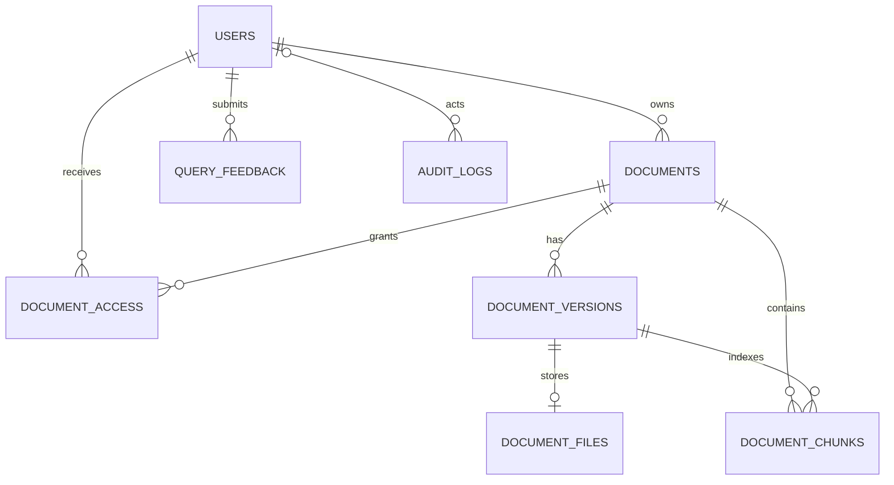

# Database design

## Overview

The application uses PostgreSQL with the `pgvector` extension. Alembic migrations are the schema source of truth. The schema stores users, owned documents and versions, original file bytes, extracted chunks and embeddings, optional access grants, feedback, and audit metadata.



## Tables

| Table | Purpose | Important columns and constraints |
|---|---|---|
| `users` | Login identity and role | UUID primary key; unique indexed email; password hash; role; active flag; creation timestamp |
| `documents` | Logical document owned by a user | UUID primary key; `owner_id`; title, filename, content type, status; current version number; JSONB metadata; timestamps; owner index |
| `document_versions` | Immutable logical version metadata | UUID primary key; document FK; version number; SHA-256 checksum; legacy `storage_path` marker; status; unique `(document_id, version_number)`; document index |
| `document_files` | Original upload bytes for a version | `version_id` primary key and FK to version; non-null binary `content`; creation timestamp. The FK cascades when the version is removed. |
| `document_chunks` | Extracted/chunked searchable text and vectors | UUID primary key; document and version FKs; chunk index; text; token count; JSONB metadata; nullable `vector(1024)` embedding; unique `(version_id, chunk_index)`; document and version indexes |
| `document_access` | Potential per-user document permission grants | UUID primary key; document/user FKs; permission string; grant time; unique `(document_id, user_id)`; indexes on both FKs. Sharing is not currently exposed as a supported product workflow. |
| `query_feedback` | User-submitted answer feedback | UUID primary key; user FK; submitted question and answer; rating; optional comment; creation time; user index |
| `audit_logs` | Metadata-only event history | UUID primary key; optional actor FK (`SET NULL` on user deletion); action/resource fields; JSONB details; creation time |

Statuses, roles, permissions, and content types are currently represented as strings in the SQLAlchemy models rather than database enums. Application validation governs their supported values.

## Relationships and lifecycle

- A user owns zero or more logical documents. Owner identity is derived from the authenticated user, not request-supplied IDs.
- Each logical document has numbered versions. `(document_id, version_number)` is unique, and `documents.current_version` identifies the active version used by retrieval.
- Each version has original bytes in `document_files`, referenced by its primary key/FK. Chunks reference both their logical document and their exact version. Search selects chunks from the current completed version.
- A changed upload with the same owner and filename creates another version. An exact same-owner duplicate is detected before expensive extraction and embedding.
- Removing a document cascades to versions, files, access grants, and chunks according to foreign-key relationships. User deletion does not have cascade configured for owned documents or feedback; user deletion therefore requires an explicit retention/deletion workflow.
- Feedback stores question/answer text by design for review. Audit event details should remain metadata-only and must not contain private document excerpts or credentials.

## Embeddings and retrieval storage

`document_chunks.embedding` is `vector(1024)`, matching `BAAI/bge-large-en-v1.5`. The query path calculates vector distance and PostgreSQL full-text ranking over chunk content, then fuses and reranks candidates in application code.

The current migrations define regular foreign-key/uniqueness indexes but do not define a pgvector ANN index (HNSW/IVFFlat) or a dedicated full-text GIN index. The current queries may therefore become slower as chunk counts grow. Measure query plans and representative latency before adding indexes; an ANN index also changes recall/latency tradeoffs and should be evaluated with the fixed retrieval set.

Do not mix vectors generated by different encoders. A model or dimension change requires a deliberate migration/re-embedding plan; changing only the model configuration leaves existing vectors incompatible semantically even when the dimension is unchanged.

## Migrations and legacy files

Alembic revisions currently create the initial schema and add `document_files`. Apply them from the repository root:

```powershell
$env:PYTHONPATH = (Resolve-Path .\backend).Path
python -m alembic upgrade head
```

The legacy file importer is `scripts/migrate_document_files.py`. It copies local originals into PostgreSQL, verifies checksums, and does not remove source files. Run a verification-only pass and review its result before manually deleting any legacy copy. Never downgrade the `document_files` migration while it contains uploaded bytes; the downgrade deliberately refuses to drop a non-empty table.

## Connection and pooling

The application loads `.env` from the repository root. `DATABASE_URL` may provide a complete connection string; otherwise the connection uses `POSTGRES_PASSWORD`, `DATABASE_HOST`, and `DATABASE_PORT` with the `enterprise_rag` database and `rag_user` account. Local example defaults use `127.0.0.1:5433`; Compose uses service configuration and container networking. SQLAlchemy enables `pool_pre_ping` with a pool size of 5 and up to 10 overflow connections per process.

Do not put live credentials in this document or commit `.env`. Configure PostgreSQL authentication, network access, encrypted backups, retention, and restore tests for the target deployment. PostgreSQL persistence alone is not a backup strategy.

## Data protection notes

- Original files and extracted content may contain confidential information; restrict database access and protect backups.
- Downloads, document reads, retrieval, version operations, and deletion must apply the same owner/admin authorization checks.
- Audit metadata is admin-restricted. Feedback has an explicit retention/privacy impact because it stores submitted Q&A content.
- Document sharing and a formal retention/erasure policy are not currently implemented.
