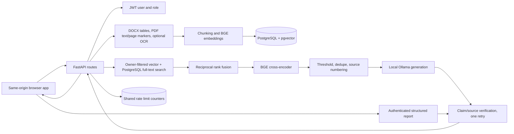

# LLM Engineering Audit

Audit date: 2026-10-25 (evaluation refresh: 2026-10-29)

## Architecture and request flow

The query and report routes obtain identity from an active JWT-backed database user. Retrieval paths filter by `documents.owner_id` (admins intentionally search across owners), select the current completed document version, and return passages to local Ollama. Generated claims undergo deterministic citation-ID checks and an optional local verifier estimate. The report route reuses this verified answer path and assembles Markdown; the dependency-free frontend can download Markdown or print to PDF. PostgreSQL stores users, document/version metadata, chunks, embeddings, and, after the new migration is applied, originals in `document_files`. Redis supports shared rate limiting.

## Feature inventory

| Area | Status | Evidence and limits |
|---|---|---|
| Upload, versioning, duplicate detection | Implemented | Authenticated PDF/DOCX/TXT/Markdown uploads, 20 MiB limit, SHA-256 duplicate detection, per-owner versions, rollback, and tests. |
| Original file persistence | Implemented in code; migration pending | New originals are PostgreSQL `LargeBinary` rows keyed by version. `scripts/migrate_document_files.py` imports and verifies legacy files but has not been run against the user's database. The API has no local-file fallback. |
| Extraction | Partial | TXT/Markdown UTF-8; PDF selectable text via pypdf with page markers; DOCX paragraphs and ordered table rows. PDF tables are not semantically parsed. Scanned-page OCR is opt-in and requires external local Tesseract/Poppler binaries; images/charts are not interpreted. |
| Embeddings and retrieval | Implemented | `BAAI/bge-large-en-v1.5` (1024 dimensions), PostgreSQL pgvector and English FTS, RRF, `BAAI/bge-reranker-base`, current-version and owner filters, exact-content deduplication. |
| Retrieval calibration | Partial | Current code default reranker threshold is `0.001`; the latest run also records `0.001` from the environment. The threshold sweep post-filters only the already-returned top five and is not a full-pipeline comparison. The latest complete run records 34/34 cases, document-level Recall@5 1.0, chunk-complete Recall@5 0.9655, chunk MRR/nDCG@5 0.9655/0.9739, and 91.18% overall pass. These figures do not prove semantic correctness. |
| Answer generation | Implemented | Ollama only (`qwen3.5:4b` default), separate system/user messages, context described as untrusted, evidence abstention when retrieval is empty, citations constrained to returned source numbers, safe upstream errors. |
| Prompt injection resistance | Partial | Context is explicitly untrusted in the system prompt and is not interpolated into the system message. No adversarial query/document regression suite or layered input risk handling exists. A prompt alone cannot guarantee resistance. |
| Citation/claim verification | Implemented with limits | Deterministic source-label membership checks plus an optional per-claim local Ollama estimate. Uncited discourse lead-ins and headings are skipped, cited factual sentences are retained, and unsupported sentences are removed while at least one claim is supported; one constrained retry and abstention occur only when no claim is supported. It is not proven hallucination detection. |
| Evaluation | Partial | Fixed versioned 34-case suite with direct, paraphrase, multi-fact, multi-document, adversarial-input, unsupported/incomplete-evidence, retrieval/rank, lexical expected-fact, citation, abstention and latency checks. Retrieval labels include expected document filenames plus pinned fixture chunk indexes, and the report scores complete chunk recall, per-label chunk recall, chunk MRR, and chunk nDCG@5. Conflicting-evidence behavior is covered by a deterministic mocked verifier regression and one live conflict question, but there is no dedicated conflicting corpus fixture. The optional local Ollama/BGE RAGAS run scored 29 usable answerable cases; its same-run baseline artifact has not yet been RAGAS-scored. |
| Reports | Implemented, export/UI checks pending | Authenticated report endpoint calls the verified answer service, validates citation IDs and returns structured Markdown; browser can download Markdown or print/save PDF. Reports are generated on demand, not persisted. |
| Knowledge graph | Missing; not justified yet | Current fixtures and metrics do not establish a multi-hop failure requiring a graph. A Neo4j service would add operational and authorization burden without demonstrated benefit. |
| Authentication and authorization | Implemented with known deployment limitations | Argon2 password hashes, short-lived JWT, active-user lookup, member-only self-registration, admin-only audit. `DocumentAccess` sharing is not implemented; admin can access every document. No MFA, refresh, recovery, or SSO. |
| Observability | Partial | Request ID, path/status/duration JSON logs; audit metadata and feedback. No retrieval-source metrics, verification events, or phase latencies are logged as a unified trace. Prompt/context bodies are intentionally omitted. |
| Frontend | Implemented, browser verification outstanding | Login/signup, password visibility, document library/upload/detail/version/download/delete, grounded chat/citations, reports, feedback, admin audit. Browser keyboard, screen-reader, responsive, print/export, and cross-browser behavior remain unverified. |
| Deployment | Local/Compose baseline | Docker/Compose, PostgreSQL, Redis, Ollama, model cache, health checks. No live build, database migration/import, restore, TLS proxy, or production load test was performed in this audit. |

## Prompt and citation behavior

Generation instructions require evidence-only answers, explicit abstention, and source labels. Retrieved passages and the user question are both in a user-role message while the system instruction is separate; this is an improvement over placing retrieved data in the system prompt, but untrusted text still reaches the same model request. There is no independently enforced prompt-injection detector. Generation removes nonexistent source labels and rejects an answer without a valid label when sources exist. This validates label integrity only; it does not establish entailment.

## Data and storage design

PostgreSQL owns document/version metadata, chunks, vectors, and new original-file blobs. Original bytes are limited to 20 MiB per upload. Legacy `stored_documents/` content requires the explicit checksum-verifying importer; files are retained by that utility. Extraction currently produces one flattened text string and chunk metadata has filename/index but no page/table provenance. Token counts use the BGE tokenizer. The existing `DocumentAccess` table has no application-level sharing flow.

## Evaluation interpretation

The latest complete artifact is `reports/evaluation/enterprise_rag_evaluation_20261029T072902Z.json` (34/34 cases, live local services). It supersedes the earlier pre-fix artifact that reported 51.72% verified approximate expected-fact accuracy against a 96.43% verification-disabled baseline and withheld 14 answerable cases. That gap was caused by uncited lead-in sentences being verified as factual claims and then all-or-nothing rejection withholding whole answers. The current run has no withheld answerable cases, verified accuracy is 93.10% versus 92.86% for the baseline (scored over 28 of 29 answerable cases because one baseline generation failed), and four answers had unsupported sentences removed. Pinned chunk labels expose one passage-retrieval miss that document-level recall hides. The separate RAGAS run scored 29 usable answerable cases: faithfulness 0.9713, answer relevancy 0.8852, context precision 0.9425, and context recall 0.9598. These local model estimates and lexical checks do not prove factual correctness or citation entailment. The threshold sweep remains post-filter-only. No RAGAS baseline comparison is available because the paired baseline has not been scored.

## Security and technical debt

- JWT `sub` resolves to an active database user on every protected request; public identity is not client-supplied. Admin role and client address trust depend on deployment/database configuration.
- Prompt-injection handling relies on system instructions, structured JSON separation, and an advisory pattern counter; prompt injection cannot be reliably detected by regex. Retrieved passages remain untrusted model input.
- Citation membership is not citation support; a sentence can still be unsupported despite a valid label.
- The 20 MiB file limit bounds but does not eliminate PostgreSQL blob growth. Backups/restore must include `document_files`.
- A failed PostgreSQL migration/import must leave legacy files untouched. The utility is designed to retain them, but live-database operation remains unverified.
- Existing evaluation docs contain historical metric values and must remain explicitly tied to the JSON run/configuration they describe.
- Browser keyboard, screen-reader, responsive, and cross-browser behavior remains unverified.

## Incremental implementation plan and file impact

1. **RAG hardening:** implemented as described above; focused tests exist. Model-based checks remain heuristic and optional.
2. **Evaluation:** optional RAGAS adapter/extra dependencies and version metadata added. A compatible same-run verification-disabled baseline artifact exists, but has not yet been scored with RAGAS; score it with the same judge, embeddings, and dataset before reporting RAGAS deltas.
3. **Reports:** authenticated endpoint, service, Markdown output and frontend page added. PDF is user-triggered browser print/save; no server-side PDF renderer or report persistence.
4. **Document understanding:** DOCX table rows and PDF page markers are retrievable; OCR is opt-in and the Tesseract/Poppler binaries and live scanned-PDF path are not installed/verified here. PDF tables, charts/images, OCR confidence warnings, and per-chunk structured provenance remain incomplete.
5. **GraphRAG assessment:** deferred. Current five-document use case and fixed evaluation do not demonstrate a multi-hop retrieval failure sufficient to justify a graph store. The multi-document case is an initial signal only, not enough for graph integration.

No embedding model, hybrid retrieval architecture, database engine, or answer-generation provider change is proposed.

## Audit verification baseline

The pre-change local test baseline was 70 passing tests. After the evaluation and repository cleanup updates, the mocked/offline suite reports **122 passed**. The 2026-10-29 live evaluation completed 34/34 cases; the separate local RAGAS run scored 29 usable answerable cases with no metric failures. Unit tests mostly mock provider/session behavior; they do not prove migrations, OCR binaries, browser behavior, or semantic correctness. The live RAG run exercised PostgreSQL, BGE models, and Ollama.
